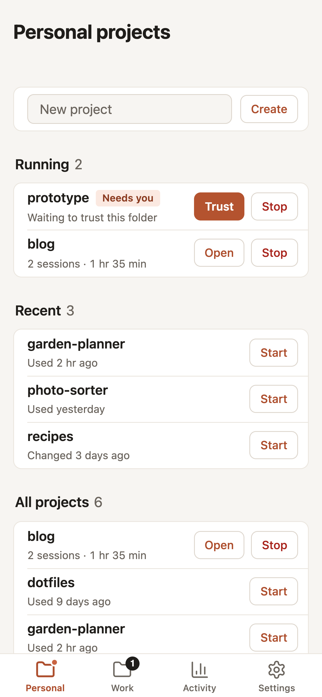

# Claude Launcher

A one-page web app for starting and stopping Claude Code Remote Control servers on your Mac from your iPhone, over Tailscale.

The page has a toolbar at the bottom with a page for each project group set in config.local.json (for example ~/dev/personal and ~/dev/work), Activity and Settings, and opens on the page you last used. Start runs `claude remote-control` in a project folder inside a detached tmux session, one server per project. New sessions opened for it from the Claude iPhone app (or the Open link) run in that folder and are named after the project.

- A group's page has New project (makes an empty folder with the name you type and starts a server in it), Running, Recent and All projects. Its tab shows how many servers are running there, or a dot when one is waiting for Trust.
- Recent means you used Claude in the project lately, read from Claude Code's session logs; projects with no Claude use fall back to their newest file change (a capped scan that skips hidden and build folders, cached for 5 minutes).
- Activity reads the same logs (every account's, read-only, the last 60 days) to show time with Claude per day, time per project, sessions, output tokens, and projects not used in 14 days. Time counts minutes with messages plus gaps of up to 5 minutes. The logs are re-read at most once a minute, and only files that changed.
- Settings, saved in the browser: the account (with more than one), rows shown before a list folds, the recent window and count, and the theme.
- Pull down from the top of a page to reload it. Group pages also refresh every 15 seconds.
- A group's tab uses its "short" name from config.local.json, or the title without "projects".

With more than one Claude account (for example personal and work), each project group belongs to one account, and a switch at the top of Home shows one account at a time: the toolbar and Home show only that account's groups, and Home shows who it's signed in as. Servers for both accounts can run at once; the switch only changes what the page shows, and its tabs count each account's running servers. The Claude iPhone app only lists Remote Control servers for the account it's signed in to, so switch accounts there too.

URL (tailnet only): https://<mac-name>.<tailnet>.ts.net/rc

## Requirements

- Node 20.11 or newer (launchd uses /opt/homebrew/bin/node). No npm packages.
- tmux (`brew install tmux`).
- The Claude CLI logged in with a claude.ai account (`claude auth login`). Remote Control doesn't work with API keys.
- Tailscale.
- If projects are symlinked into Dropbox or another protected folder, give node and tmux Files and Folders access to it (System Settings, Privacy & Security).

## Setup

1. Create the config, then set allowedLogin to your Tailscale login and list your project folders:

        cp config.example.json config.local.json

   For more than one account, add "accounts" (each with an id, title and configDir) and give each group an "account"; see config.example.json. ~/.claude is the CLI's default folder. Sign in to each other account once on the Mac, for example:

        CLAUDE_CONFIG_DIR=~/.claude-personal claude auth login

   Each config folder has its own settings, skills, CLAUDE.md, memory and session history. To share the global ones, symlink them from ~/.claude:

        cd ~/.claude-personal && ln -s ../.claude/CLAUDE.md ../.claude/settings.json ../.claude/skills .

2. Install the launchd agent (run from this folder):

        sed "s|__REPO__|$PWD|g" launchd/claude-launcher.plist.template > ~/Library/LaunchAgents/local.claude-launcher.plist
        launchctl load -w ~/Library/LaunchAgents/local.claude-launcher.plist

3. Expose it on the tailnet:

        tailscale serve --bg --set-path /rc http://127.0.0.1:8766

4. On the iPhone, open the URL in Safari and use Add to Home Screen.

After code changes: `launchctl kickstart -k gui/$(id -u)/local.claude-launcher`. Server log: server.log.

## Working with sessions on the Mac

- List: `tmux ls` (launcher servers are named rc-<group>-<project>, for example rc-personal-myapp).
- Watch one: `tmux attach -t <name>`, detach with Ctrl-b d.

## Limitations

- The Mac must be awake and online. A Remote Control session exits after about 10 minutes without a network connection.
- Servers keep running until stopped from the page, Ctrl-C in the tmux session, or a reboot. Stop sends Ctrl-C so the server can shut down cleanly; it force-kills the tmux session after 5 seconds.
- Start also opens one session in the project folder, named after the project (`--name`). Sessions aren't archived when the server stops; archive them in the app.
- New projects show up automatically; the page refreshes every 15 seconds and when it comes back to the foreground.
- In a folder Claude Code hasn't trusted yet (including every new project), the server waits at the "trust this folder" prompt and the page shows a Trust button. The CLI ignores answers that arrive too quickly, so the launcher never answers it on its own.
- Project names may use letters, numbers, dot, dash and underscore, and must start with a letter or number.

## Troubleshooting

- Page doesn't load: `launchctl list | grep claude-launcher`, then check server.log. Check `tailscale serve status` shows /rc.
- Start says an account isn't signed in: run the `claude auth login` command the page shows, on the Mac.
- Server never shows an Open link or never appears in the app: `tmux attach -t <name>` to see what it's waiting on. Common causes are a logged-out CLI (`claude auth status`) or a macOS file-access prompt for a protected folder.

## Security

The page can start processes on your Mac. It listens only on 127.0.0.1 and is reachable only through `tailscale serve`. Requests from any Tailscale login other than allowedLogin (or the ALLOWED_LOGIN environment variable) are refused; the server won't start without one. POSTs must be JSON, start only accepts folders from the project list, and create only makes a new folder directly inside a configured group.

## Files

- server.mjs: HTTP server, project listing, starting and stopping servers in tmux.
- public/: page, manifest, icons.
- config.example.json: copy to config.local.json (not committed).
- launchd/claude-launcher.plist.template: keeps the server running.

## License

MIT. See LICENSE.
